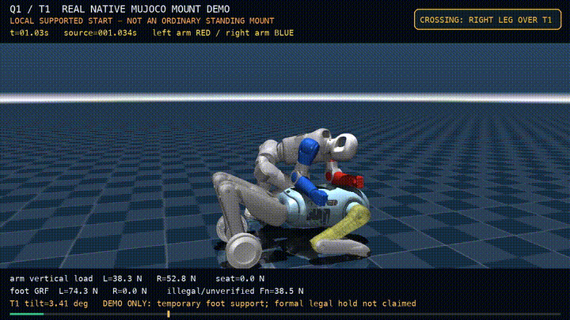

# Q1/T1 Mount & Ride Skill

## 基于强化学习的双机器人上马与辅助骑乘技能

本项目研究启元 Q1 人形机器人如何从 T1 四足机器人侧方的局部扶撑状态出发，完成右腿绕后髋跨越、右手回撑和前倾骑乘保持。项目使用 MuJoCo 中的真实自由基座、动力学碰撞、关节限制、力矩限制和动态 T1，不以规划轨迹或隐藏外力代替动力学执行。

> **状态说明**：当前交付是局部扶撑初点的仿真 Demo，不是普通站姿自主上马，也暂未应用到真机中。



[观看完整 17 秒真实 MuJoCo Demo](assets/Q1T1_mount_demo_handload_cross17_17s.mp4)

## 项目成果

已验证候选完成了连续的：

`局部扶撑起点 → 右腿后摆 → 绕 T1 后髋跨越 → 右手回撑 → 前倾手臀辅助支撑`

| 指标 | 实测结果 |
|---|---:|
| 动作起点 | 保存的局部扶撑跨腿初态 |
| 跨越完成 | 约 **4.90 s** |
| 跨后连续未摔倒保持 | 约 **12.10 s** |
| 右手合法承重 | 末 1 秒约 **14.2 N** |
| seat 载荷 | 末 1 秒约 **52.9 N** |
| 左脚 / 右脚地面反力 | 末 1 秒约 **13.3 / 36.4 N** |
| 最大关节越限 | 约 **9.25 mrad** |
| T1 最大倾角 | 约 **5.33°** |
| hard guard 或摔倒 | 无 |
| 正式合法 hold | **0 s** |

当前动作仍包含左脚和右脚借地、左肘壳、右髋壳以及踝/腿壳等未核准接触。视频中这些限制未被隐藏，也不能据此宣称完整合法坐稳或硬件部署成功。

## 机器人平台

### 启元 Q1 人形机器人

Q1 在本项目中是执行上马与辅助支撑动作的双足人形机器人。

官方公开规格：

- 身高：**88 cm**
- 整机重量：约 **16 kg**（含电池）
- 全身自由度：**22**（双臂 4×2、双腿 6×2、腰部 2）
- 日常最大移动速度：**1 m/s**
- 电量：**215 Wh**
- 综合续航：约 **3 h**
- 室温充电时间：**≤ 1.5 h**，支持直充和换电

官方页面：

- [Q1 产品页](https://www.primebot.com/productinfo4.html)
- [Q1 技术参数](https://www.primebot.com/product_spec4.html)
- [启元开发者下载中心](https://dev.primebot.com/download)

### 启元 T1 四足机器人

T1 在本项目中是被跨越和扶撑的动态平台，其运动髋壳、背部支撑面和载荷响应均保留在仿真中。

官方公开规格：

- 身高：**100 cm**
- 整机重量：约 **16.3 kg**（T1）；约 **16.8 kg**（T1 Pro）
- 载荷：**≤ 3 kg**
- 最大移动速度：四足 **3 m/s**；轮足 **2.5 m/s**

官方页面：

- [T1 产品页](https://www.primebot.com/t1.html)
- [T1 技术参数](https://www.primebot.com/product_spec1.html)
- [官方 Q1/T1 URDF 与 SDK 下载](https://dev.primebot.com/download)

机器人名称、产品外观和相关商标归其权利人所有。本仓库不分发原厂 STL、基础 Policy 或官方 SDK。

## 技术路线

```text
参考动作 / Motion Retargeting
            │
            ▼
430 维 reference-conditioned observation
            │
            ▼
PPO actor ── 原 PD / 关节限制 / 力矩限制
            │
            ▼
MuJoCo：Q1 自由基座 + 动态 T1 + 真实碰撞
            │
            ├── Contact-Aware 支撑与非法接触审计
            ├── RSI 跨后状态恢复课程
            └── Mild Domain Randomization 稳定性评测
```

### MuJoCo 动力学

项目使用 MuJoCo 3.16.0：

- Q1 和 T1 均为真实自由基座；
- 保留原始 mesh 碰撞、关节范围、PD、力矩上限和重力；
- T1 由独立 PD 保持/运动，未焊接到 Q1；
- 执行过程中不使用 mocap、固定 root、mid-episode reset 或隐藏外力。

### Motion Retargeting 与 VideoMimic 参考路线

项目借鉴 VideoMimic、DeepMimic 等工作将参考运动转换为机器人可跟踪状态的思路，并使用 reference-conditioned observation 训练策略。

当前仓库**真正实现**的是：

- 已有真实状态的 motion/reference 重定向与分段课程；
- `430 = 5×72` 状态历史 + 当前/100 ms/200 ms 参考关节目标 + 参考重力 + 相位；
- 参考目标与 PPO 残差共同生成 PD 目标；
- 跨后实际状态 reset 的 RSI 课程。

当前仓库**没有实现**：

完整 VideoMimic 的真实视频到仿真重建、人在环视频解析、单策略多场景泛化，以及视频到真机的完整 real-to-sim-to-real 管线。VideoMimic 与 DeepMimic 在此作为方法和论文参考，不应描述为本项目的直接复现。

### PPO 与 RSI

策略使用 clipped PPO，从已有跨腿/恢复 checkpoint 继续训练：

- actor 输出 22 维归一化动作；
- 底层使用原始 PD、关节限制和力矩裁剪；
- critic 使用相同 430 维可部署观测；
- RSI 从真实跨后、右手接载和 seat 预载状态构建；
- reset 状态保留 `qpos/qvel`、观测历史、上一动作和控制权限；
- 每次实验保存完整配置、checkpoint、日志和独立 native 评测。

### Contact-Aware Control

接触审计区分：

- 合法腕/掌与 T1 `BASELINK`；
- 合法 seat 与 T1 `BASELINK`；
- 脚与地面；
- 髋壳、肘壳、腿壳等未核准接触；
- 自接触、地面非脚接触、穿透和关节越限。

策略权限、固定参考、PD 和碰撞模型始终保留。接触力仅用于训练 shaping、critic 或离线评价，部署 actor 不直接读取 MuJoCo 特权接触力。

### Mild Domain Randomization

已完成的 16-update 有界实验对以下因素进行了小范围随机化：

- 接触摩擦：标称 **±10%**；
- PD 增益：标称 **±5%**；
- 初始 root 位置：约 **±1 cm**；
- 初始关节角：约 **±2°**；
- RSI source 与 reset 相位。

共享 MuJoCo Warp 模型没有 per-world mass 字段，因此质量随机化被明确标记为 deferred，没有用隐藏外力伪造 ±3% 质量变化。

## 实验结果与边界

### 439 维 PPO 筛选

在 430 维观测后追加 9 维可部署 T1 相对骨盆位置、速度和头部姿态误差后，累计进行了 64 accepted updates。候选没有形成合法 hold，右脚仍约 36.9 N 借地，也未同时改善合法手臀承重和非法接触，因此未晋升。

### 16-update Mild-DR PPO

从受保护的 handload checkpoint 完整 warm start，完成：

- **16/16 accepted updates**
- **65,536 environment steps**
- 约 **493 s**
- 无 safety stop

随后在 nominal 和 3 个 light-DR seed 上执行 17 秒 native 复测：

| 模型 | 环境 | 跨越 | seat | 右脚 | 未核准 T1 Fn | 结论 |
|---|---|---:|---:|---:|---:|---|
| Handload 父模型 | nominal | 4.94 s | 51.1 N | 35.3 N | 89.0 N | 保留 |
| DR-PPO16 | nominal | 4.90 s | 31.0 N | 36.7 N | 90.4 N | 拒绝 |
| Handload 父模型 | DR seed 1 | 5.04 s | 35.1 N | 0 N | 149.8 N | 对照 |
| DR-PPO16 | DR seed 1 | 5.10 s | 29.9 N | 0 N | 159.3 N | 退化 |

两个 DR seed 中，候选 seat 承重进一步降至 `0 N`。因此该 checkpoint 被保留用于审计，但没有晋升或替换 Demo 模型。

[查看拒绝候选的真实 native 视频](assets/light_dr_ppo16_rejected_nominal.mp4)

## 仓库结构

```text
.
├── README.md
├── LICENSE                    # 仅覆盖本项目原创代码
├── THIRD_PARTY_NOTICES.md
├── pyproject.toml
├── configs/
│   ├── demo_handload_cross17.json
│   └── dr_light.json
├── skill/
│   ├── controller.py          # 430 维观测与动作权限
│   ├── executor.py            # 无 reset 闭环 MuJoCo 执行
│   ├── phases.py              # 跨越与骑乘阶段
│   ├── replay.py              # 真实保存轨迹 MP4/GIF 渲染
│   └── authority/             # 冻结的左右臂权限映射
├── evaluation/
│   ├── evaluate_run.py
│   └── render_demo.py
├── training/
│   ├── README.md
│   ├── RESULTS_light_dr_ppo16.md
│   └── run_dr_screen.py
├── docs/
│   ├── EXPERIMENT_SUMMARY.md
│   └── light_dr_ppo16/
└── assets/
    ├── demo_preview.gif
    ├── demo_poster.png
    ├── Q1T1_mount_demo_handload_cross17_17s.mp4
    └── light_dr_ppo16_rejected_nominal.mp4
```

原厂模型、基础 Policy、reference motion、训练 source bank 和授权受保护的 checkpoint 不在 public 仓库中。

## 安装

```bash
git clone https://github.com/GARERYIES/q1-t1-mount-riding-skill.git
cd q1-t1-mount-riding-skill

python3 -m venv .venv
source .venv/bin/activate
python -m pip install --upgrade pip
python -m pip install -e .
```

依赖版本记录在 `pyproject.toml`。推荐 Python 3.10-3.12、MuJoCo 3.16.0。

## 受限资产与复现

由于缺少明确的第三方再分发许可，以下文件未上传：

- 原厂 Q1/T1 STL、mesh 和组合 MuJoCo XML；
- 基础 Policy、训练得到的 TorchScript actor 和 PyTorch checkpoint；
- 原始 reference motion；
- 原始 `qpos/qvel`、native contact force 和训练 source bank。

官方 Q1/T1 URDF、SDK 和 PDF 可从 [启元开发者下载中心](https://dev.primebot.com/download) 获取。官方 URDF 不保证与本研究使用的组合场景完全一致，直接替换前需要重新核对质量、碰撞、坐标系和关节语义。

获得授权后，将依赖放入以下位置：

```text
model/scene.xml
model/meshes/*
checkpoints/handload_actor.ts
data/reference_B.npz
data/initial_state_B_t3.npz
data/control_contract_v1.json
data/handload_cross17_trajectory.npz
data/handload_cross17_metrics.jsonl.gz
```

然后运行：

```bash
# 查看配置和代码回归
python -m unittest discover -s tests -v

# 从真实初态闭环执行 17 秒
python -m skill \
  --config configs/demo_handload_cross17.json \
  --out outputs/nominal_17s

# 对保存的真实 native 状态重新渲染 MP4
python -m skill.replay \
  --config configs/demo_handload_cross17.json \
  --trajectory data/handload_cross17_trajectory.npz \
  --metrics data/handload_cross17_metrics.jsonl.gz \
  --out outputs/demo.mp4

# 独立检查一次闭环运行
python evaluation/evaluate_run.py outputs/nominal_17s

# nominal + 轻量 DR 17 秒筛选
python training/run_dr_screen.py \
  --config configs/demo_handload_cross17.json \
  --out outputs/dr_screen \
  --duration 17 \
  --seeds 1 2 3
```

没有受限资产时，集成测试会自动跳过；阶段和配置单元测试仍可运行。完整 PPO+RSI 训练数据同样受资产授权限制，public 仓库只保留训练入口、协议说明和已发表结果。

## 评价口径

每次 native 评测至少记录：

- 右腿跨越完成时间和膝关节轨迹；
- 左右掌/前臂、seat、脚地分通道载荷；
- 每个未核准 T1/地面/自接触冲量和峰值；
- 关节原生边界越限；
- 骨盆与胸部相对 T1 的姿态和速度；
- T1 倾角与平移；
- hard guard、NaN、穿透和摔倒；
- 连续合法 hold 时长。

姿态看起来接近坐姿、reward 增加或单纯接触 T1 都不算成功。

## 已知限制

- 起点不是普通站姿，完整自主接近和上马尚未验证；
- 左手仍存在肘壳替代，双手合法支撑不完整；
- 右脚仍借地，距离完全卸载尚远；
- T1 髋壳、右踝/腿壳等未核准接触仍存在；
- 正式合法坐姿 hold 为 `0 s`；
- Mild-DR PPO16 没有改善稳定性，已拒绝；
- 没有真机实验、硬件安全认证或真实负载测试；
- public 仓库不包含受限机器人模型、基础 Policy 和训练数据。

## 参考文献

1. Schulman et al. **Proximal Policy Optimization Algorithms**, 2017.  
   [arXiv:1707.06347](https://arxiv.org/abs/1707.06347) · [Baselines](https://github.com/openai/baselines)

2. Peng et al. **DeepMimic: Example-Guided Deep Reinforcement Learning of Physics-Based Character Skills**, 2018.  
   [arXiv:1804.02717](https://arxiv.org/abs/1804.02717) · [Code](https://github.com/xbpeng/DeepMimic)

3. Allshire et al. **Visual Imitation Enables Contextual Humanoid Control**, 2025.  
   [arXiv:2505.03729](https://arxiv.org/abs/2505.03729) · [Code](https://github.com/hongsukchoi/VideoMimic) · [Project](https://www.videomimic.net/)

4. Todorov et al. **MuJoCo: A physics engine for model-based control**, 2012.  
   [DOI:10.1109/IROS.2012.6386109](https://doi.org/10.1109/IROS.2012.6386109) · [Documentation](https://mujoco.readthedocs.io/) · [Code](https://github.com/google-deepmind/mujoco) · [MuJoCo Warp](https://github.com/google-deepmind/mujoco_warp)

## 许可证

本项目原创源代码使用 [MIT License](LICENSE)。

该许可证**不覆盖**任何未随仓库分发的原厂模型、SDK、Policy、reference motion、checkpoint、产品图片或商标。Demo 视频和 GIF 仅用于展示本项目的研究结果；其中出现的机器人外观和相关权利仍归其权利人所有。详见 [THIRD_PARTY_NOTICES.md](THIRD_PARTY_NOTICES.md)。
